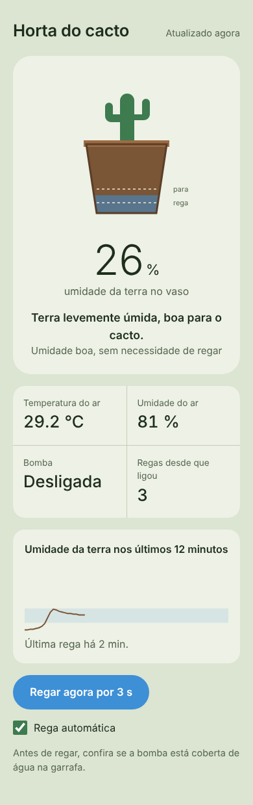
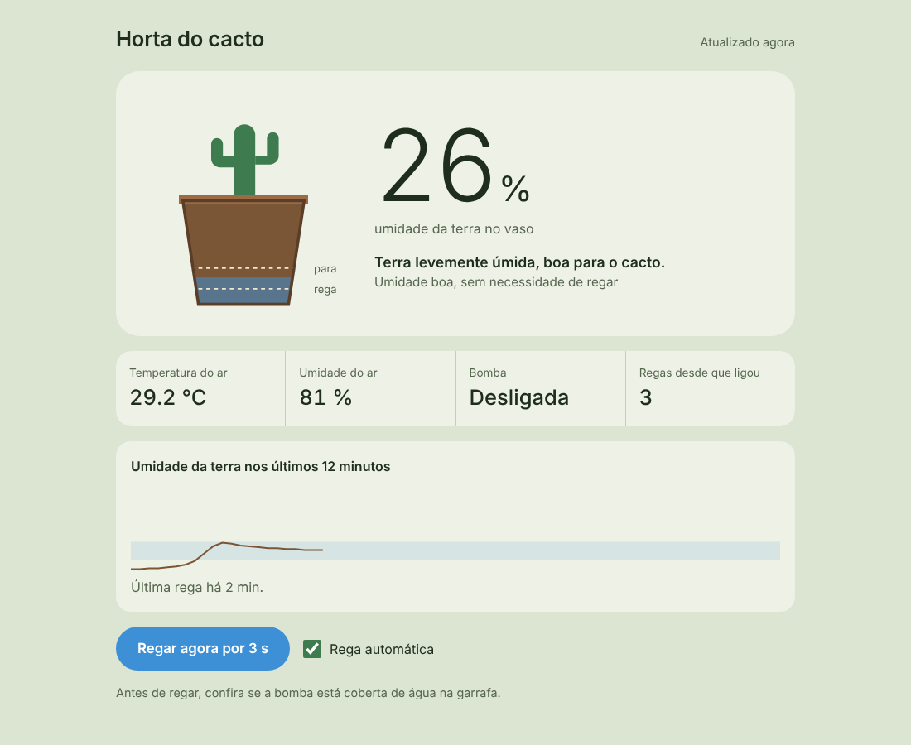
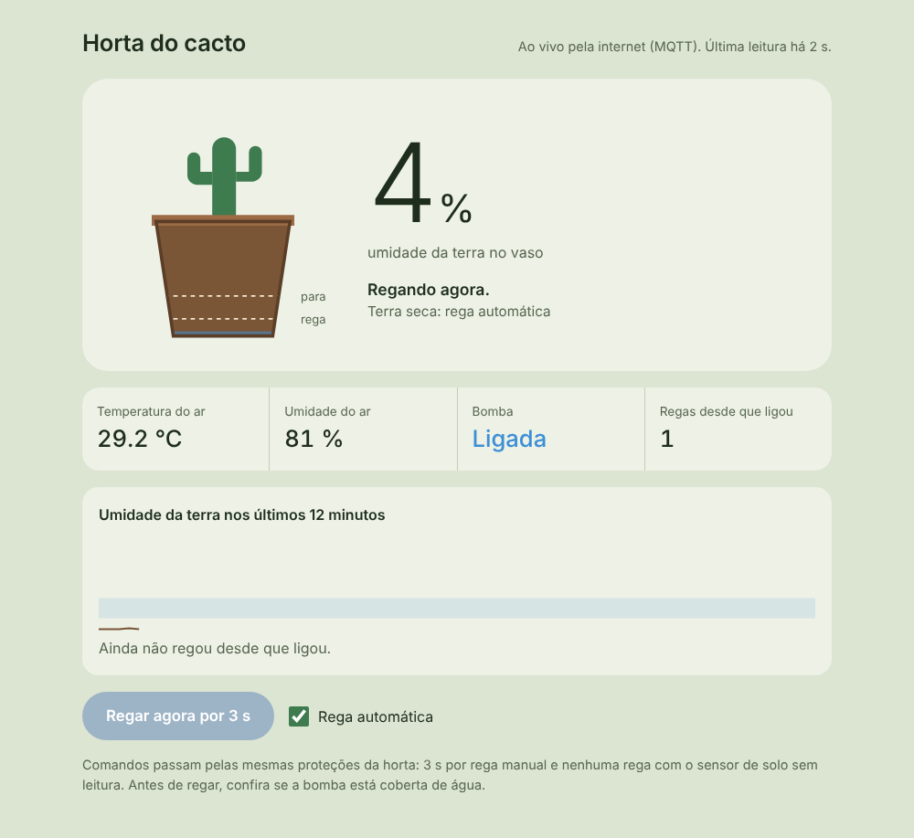

# Horta Comunitária Inteligente — ESP32

Protótipo de irrigação automática para um vaso com cacto, desenvolvido no projeto de extensão
**Atividades Práticas Interdisciplinares de Extensão III** (Ciência da Computação — Uninassau, 2026.2).

O ESP32 lê a umidade do solo, a temperatura e a umidade do ar, decide sozinho quando regar e
aciona uma mini bomba por um relé. Os dados aparecem em dois painéis:

- **Painel local**: o próprio ESP32 cria a rede Wi-Fi `HortaInteligente` e serve a página em
  `http://192.168.4.1`. Funciona **sem internet**.
- **Painel online**: o ESP32 publica as leituras por **MQTT** no broker público
  `broker.hivemq.com`, e o arquivo [`dashboard/dashboard_online.html`](dashboard/dashboard_online.html)
  mostra tudo em tempo real de qualquer lugar com internet.

A rega automática roda **no ESP32**, então continua funcionando se a internet cair.



## Sumário

- [Como funciona](#como-funciona)
- [Materiais](#materiais)
- [Ligações](#ligações)
- [Instalação e upload](#instalação-e-upload)
- [Calibração e regras de rega](#calibração-e-regras-de-rega)
- [MQTT](#mqtt)
- [Painéis](#painéis)
- [Segurança do sistema](#segurança-do-sistema)
- [Problemas comuns](#problemas-comuns)
- [Limitações conhecidas](#limitações-conhecidas)
- [Documentação extra](#documentação-extra)

## Como funciona

```
 Sensor de solo ─┐                                   ┌─► Painel local (Wi-Fi do ESP32, sem internet)
 DHT22 ──────────┼─► ESP32 ── decide ── Relé ── Bomba │
                 │      │                             └─► MQTT ─► broker.hivemq.com ─► Painel online
                 │      └── rega automática local (independe da internet)
```

1. A cada 0,5 s o ESP32 lê o sensor de solo (média de 16 leituras).
2. Se a terra estiver seca (abaixo de ~15% de umidade), liga a bomba.
3. A bomba desliga quando a terra chega a ~35%, **ou** depois de **10 s no máximo**.
4. Depois de cada rega o sistema espera **20 s** para a água infiltrar antes de decidir de novo.
5. A cada 5 s (e na hora em que a bomba muda) o estado é publicado por MQTT.

## Materiais

| Item | Observação |
|---|---|
| ESP32-WROOM-32 DevKit (30 pinos, USB-C) | placa principal |
| Sensor capacitivo de umidade do solo V2.0 | saída analógica |
| DHT22 / AM2302 (módulo com pinos +, out, −) | temperatura e umidade do ar |
| Módulo relé 1 canal 5 V (SRD-05VDC) | aciona com nível LOW |
| Mini bomba submersa 3–6 V (JT100) | fica dentro do reservatório |
| Fonte 5 V / 2 A (plug P4) + adaptador P4 fêmea com borne | alimentação **só da bomba** |
| 3× diodo 1N4007 | 2 no sinal do relé, 1 de proteção da bomba |
| Capacitor eletrolítico 470 µF / 16 V | estabiliza a alimentação da bomba |
| Protoboard 830 pontos, jumpers | montagem |
| Mangueira 5/16", garrafa PET cortada, vaso | parte hidráulica |
| Multímetro | conferência de tensões e polaridades |

## Ligações

Resumo (detalhes furo a furo em [`docs/montagem.md`](docs/montagem.md)):

| De | Para |
|---|---|
| ESP32 **3V3** | faixa vermelha (+) esquerda da protoboard |
| ESP32 **GND** | faixa azul (−) esquerda |
| DHT22 **+ / − / out** | faixa + / faixa − / **D4** |
| Sensor de solo **VCC / GND / AOUT** | faixa + / faixa − / **D34** |
| Relé **VCC** | **VIN** do ESP32 (5 V do USB) |
| Relé **GND** | **GND** do ESP32 |
| Relé **IN** | **D26**, passando por **2 diodos 1N4007 em série** (faixas viradas para o D26) |
| Fonte **⊕** | relé **COM** (borne do meio) |
| Relé **NO** | **+** da bomba |
| **−** da bomba | fonte **⊖** |
| Diodo 1N4007 | em paralelo com a bomba, faixa no **+** |
| Capacitor 470 µF | em paralelo com a bomba, perna longa no **+** |

> **Por que os 2 diodos?** O relé é de 5 V e liga com LOW. O nível HIGH do ESP32 (3,3 V) não
> é suficiente para desligá-lo, então o firmware desliga o relé colocando o pino como entrada
> ("solto"), e os diodos bloqueiam a pequena corrente que ainda vazava pelo pino e mantinha o
> relé grudado. Detalhes no [diário de bordo](docs/diario-de-bordo.md).

## Instalação e upload

1. Instale o **Arduino IDE 2.x**.
2. Em *File → Preferences → Additional boards manager URLs*, adicione
   `https://espressif.github.io/arduino-esp32/package_esp32_index.json`
   e instale **esp32 by Espressif Systems** no *Boards Manager*.
3. No *Library Manager*, instale:
   - **DHT sensor library** (Adafruit), que pede também a *Adafruit Unified Sensor*
   - **PubSubClient** (Nick O'Leary)
4. Copie `firmware/horta_inteligente/segredos.exemplo.h` para `segredos.h`, na mesma pasta,
   e preencha o nome e a senha de uma rede **2,4 GHz com internet**.
5. Abra `firmware/horta_inteligente/horta_inteligente.ino`, selecione **ESP32 Dev Module** e a
   porta COM da placa.
6. Clique em **Upload**. Se travar em `Connecting....`, segure o botão **BOOT** até aparecer
   `Writing at ...`.
7. Abra o Monitor Serial em **115200 baud**.

Cada linha do Monitor Serial mostra o estado completo e o motivo da última decisão:

```
Temp: 29.2 C | Ar: 81.1 % | Solo: 3240 (2%) | Bomba: ON | Internet: ok | MQTT: ok | Terra seca: rega automática
```

## Calibração e regras de rega

Valores medidos no sensor deste protótipo (ADC de 12 bits, 0–4095; **número alto = seco**):

| Situação | Leitura bruta |
|---|---|
| Sensor seco, no ar | ~3290 |
| Sensor na água (até a linha branca) | ~1025 |

Configuração para cacto (rega pouca), no início do firmware:

| Constante | Valor | Significado |
|---|---|---|
| `SECO` / `MOLHADO` | 3290 / 1025 | régua da calibração (0% a 100%) |
| `LIGA_ACIMA` | 2950 (~15%) | abaixo disso de umidade, rega |
| `DESLIGA_ABAIXO` | 2500 (~35%) | ao chegar aqui, para |
| `MAX_LIGADA` | 10 s | tempo máximo de bomba ligada por rega |
| `PAUSA` | 20 s | espera mínima entre regas |
| `REGA_MANUAL` | 3 s | duração da rega pelo botão do painel |

Para recalibrar, use o Monitor Serial: anote o valor de `Solo:` com o sensor no ar e na água,
e troque `SECO` e `MOLHADO`. Os limites ideais devem ser ajustados com o sensor já no substrato.

## MQTT

| Item | Valor |
|---|---|
| Broker | `broker.hivemq.com` (público, sem cadastro) |
| Porta do ESP32 | `1883` (TCP) |
| Porta do painel online | `8884` (WebSocket seguro, `wss://broker.hivemq.com:8884/mqtt`) |
| Base dos tópicos | `uninassau/hortacacto-0e80` |

| Tópico | Direção | Conteúdo |
|---|---|---|
| `.../estado` | ESP32 → painel | JSON com todas as leituras (retido) |
| `.../status` | ESP32 → painel | `online`, ou `offline` via *Last Will* quando o ESP32 cai |
| `.../comando` | painel → ESP32 | `regar`, `auto:1` ou `auto:0` |

Exemplo de `estado`:

```json
{"t":29.2,"h":81.1,"raw":3240,"pct":2,"ok":true,"pump":true,"auto":true,"regas":1,
 "ultima":-1,"pausa":0,"liga":15,"desliga":35,"motivo":"Terra seca: rega automática",
 "wifi":true,"mqtt":true,"hist":[2,2,3]}
```

Para testar sem o painel, qualquer cliente MQTT serve (ex.: MQTT Explorer), assinando
`uninassau/hortacacto-0e80/#`.

## Painéis

**Local** — conecte o celular na rede `HortaInteligente` (senha `cacto2026`) e abra
`http://192.168.4.1`. Desligue os dados móveis se a página ficar carregando.

**Online** — abra `dashboard/dashboard_online.html` em qualquer navegador com internet.

Os dois mostram: umidade do solo (desenho do vaso com as linhas de "rega" e "para"),
temperatura, umidade do ar, estado da bomba, número de regas, gráfico dos últimos 12 minutos,
botão **Regar agora por 3 s** e o interruptor da rega automática.

| Painel local (desktop) | Painel online |
|---|---|
|  |  |

> As capturas foram feitas com dados de exemplo.

## Segurança do sistema

- A bomba **começa desligada**: é a primeira linha do `setup()`.
- Limite de **10 s** por rega automática e **3 s** por rega manual.
- **Bloqueio por leitura inválida**: se o sensor de solo der valor fora de 700–3700 (fio solto),
  a bomba não liga e, se estiver ligada, desliga.
- Comandos remotos passam pelas **mesmas proteções** da rega automática.
- O ESP32 não tenta reconectar ao MQTT com a bomba ligada, para a reconexão não atrasar o
  desligamento.
- A bomba tem **fonte própria**, chaveada pelo relé; nenhuma corrente dela passa pelo ESP32.

## Problemas comuns

| Sintoma | Causa provável | O que fazer |
|---|---|---|
| `Connecting....` e depois `Wrong boot mode` | placa não entrou em modo de gravação | segurar **BOOT** durante o upload |
| `Temp: erro` | mau contato no DHT22 | conferir o fio do **D4** |
| `SENSOR?` no solo | fio do sensor de solo solto | conferir o fio amarelo no **D34** |
| Relé não clica | fio do relé no pino errado | VCC no **VIN** (não no **VN**), IN no **D26** |
| Relé fica sempre ligado | diodos ausentes ou invertidos | 2 diodos em série, faixas para o D26 |
| Bomba ON no Serial mas não gira | energia não chega à bomba | medir 5 V no adaptador e nos fios da bomba |
| `Internet: sem` | rede errada ou 5 GHz | conferir `segredos.h` e usar 2,4 GHz |
| Painel local não abre | celular usando dados móveis | desligar 4G/5G e usar `http://192.168.4.1` |

## Limitações conhecidas

- **Sem sensor de nível**: o sistema não sabe se o reservatório tem água. A bomba não pode rodar
  seca, então o uso deve ser **supervisionado** e o abastecimento manual.
- **Broker público**: quem souber o tópico consegue ler os dados e enviar comandos. Aceitável
  para protótipo de bancada; para uso real seria preciso um broker com usuário e senha (TLS).
- **Relé de 5 V** em vez de um módulo compatível com 3,3 V: funciona com o ajuste dos diodos,
  mas um relé de 3,3 V (ou com optoacoplador e JD-VCC) seria a solução mais limpa.
- O histórico do painel guarda só os últimos 12 minutos e é zerado quando o ESP32 reinicia.
- O acompanhamento contínuo de uma semana previsto na proposta não foi realizado; a validação
  ficou restrita aos testes em bancada e aos testes de falha.

## Documentação extra

- [`docs/montagem.md`](docs/montagem.md): montagem passo a passo, furo a furo.
- [`docs/diario-de-bordo.md`](docs/diario-de-bordo.md): problemas encontrados, como foram resolvidos,
  testes de falha e situação final.

## Equipe

Davi Ramos Ferreira, Gabriel Pinheiro Moneta, Igor Fonseca Ferreira Santos,
João Mariano Leite Valadares e Luiz Fellipe Lima de Araujo.
Professor: Marlon Silva Ferreira.
